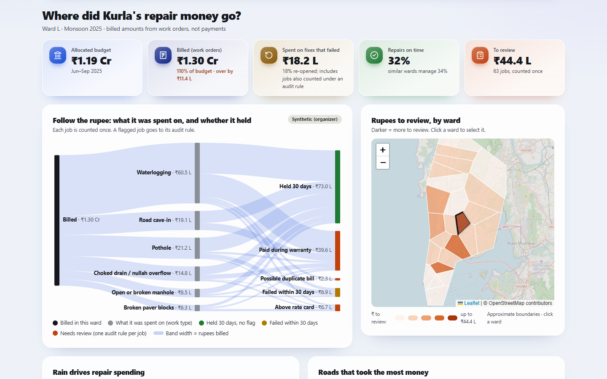
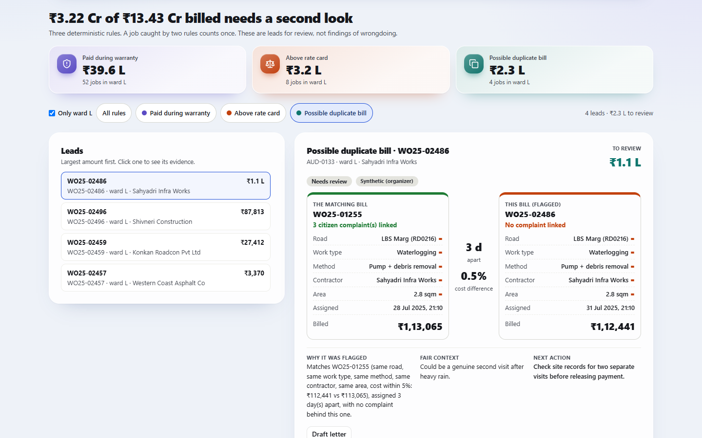
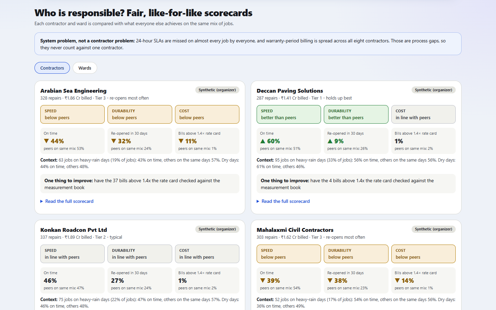
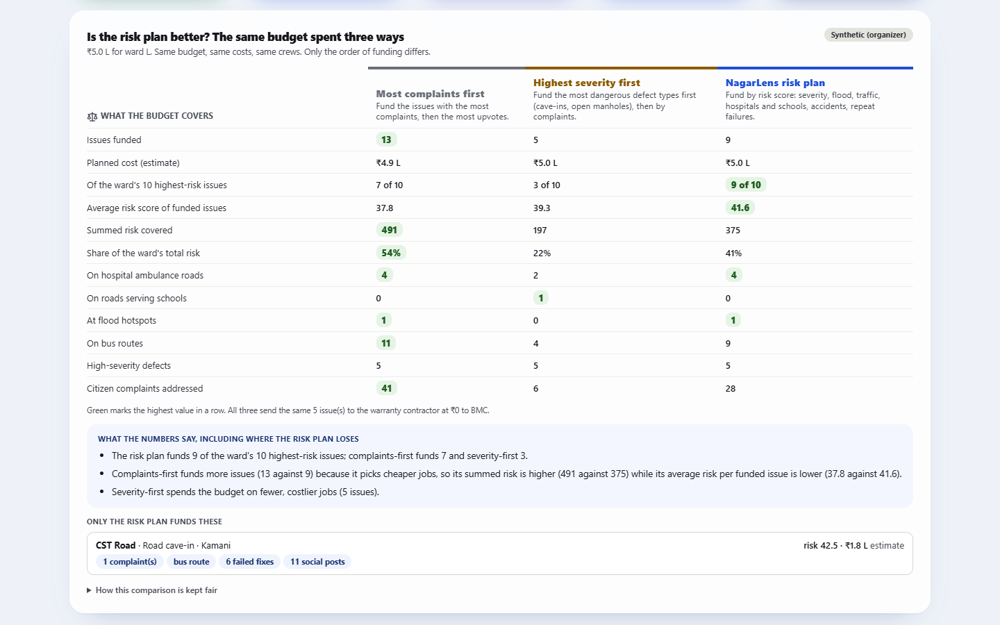
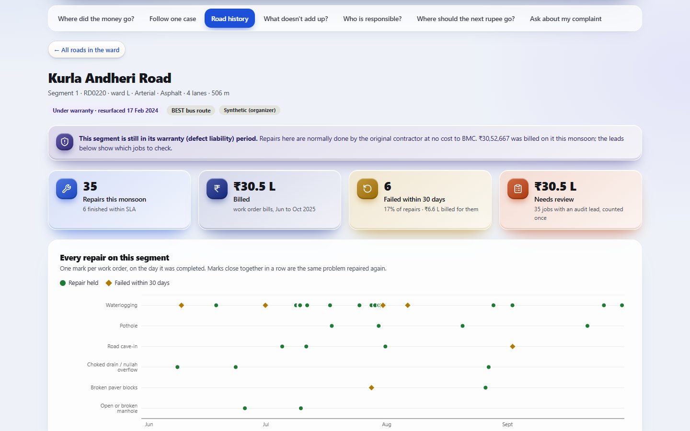
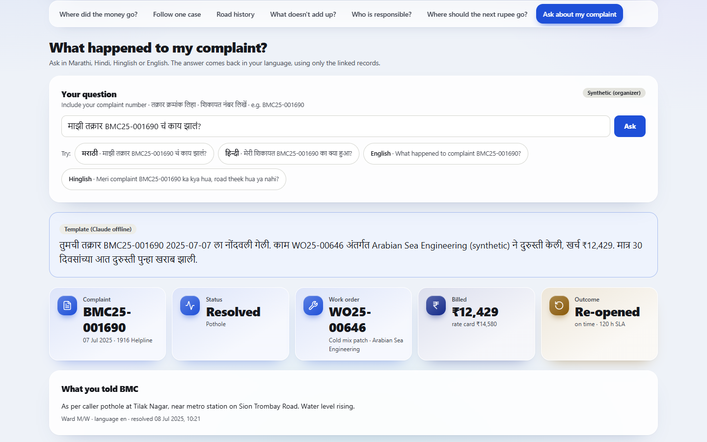

# NagarLens

**Team 11 · Claude Impact Lab Mumbai · 21 Nov 2026**

**Follow every rupee from a citizen's complaint to a fix that held.**

> **₹13.43 Cr billed for Mumbai's 2025 monsoon road repairs; ₹3.22 Cr needs a second look.**
> De-duplicated across 622 work orders (a job caught by two rules counts once). These are review leads, not findings of wrongdoing.

Built in one day for the challenge *"Follow the Rupee: where did Mumbai's road repair money go?"*. All data is synthetic; see [Data and fairness](#data-and-fairness).

---

## Demo

- **Demo video (2 min, narrated):** [nagarlens_demo.mp4](https://github.com/Mandark-droid/NagarLens/releases/download/demo-video/nagarlens_demo.mp4) · [release page](https://github.com/Mandark-droid/NagarLens/releases/tag/demo-video)
- **Live app:** <https://kshitijthakkar-nagarlens.hf.space> ([Hugging Face Space](https://huggingface.co/spaces/kshitijthakkar/nagarlens)). The hosted copy runs without a Claude API key, so its AI panels show cached answers or template text, and officer decisions reset when the Space restarts. Deployment notes: [deploy/README.md](deploy/README.md).
- **Run it locally:** see [Quick start](#quick-start).

| | |
|---|---|
| <br>**Where did the money go?** Ward totals, the money flow from work type to outcome, and rupees to review by ward | <br>**What doesn't add up?** A possible duplicate bill next to its match, with the reason, fair context and next action |
| <br>**Who is responsible?** Like-for-like contractor scorecards with rain context | <br>**Where should the next rupee go?** The same ₹5 L spent three ways, including where the risk plan loses |
| <br>**Road history:** every repair on one road segment, whether it held, and its warranty status | <br>**Ask about my complaint:** asked in Marathi, answered in Marathi from the linked records |

---

## The problem

Every monsoon, Mumbai pays to fix the same roads again. Citizens complain, repairs get logged and the potholes come back. Nobody can easily answer three questions:

1. **Where did the money go?**
2. **Did the fix last?**
3. **Who is responsible?**

Our pitch is **"Recover, then reinvest."** About ₹3 Cr went on repairs to roads still under warranty, duplicate bills, and charges above the rate card. NagarLens shows how to get that money back and where each ward should spend next.

| Judging criterion | How NagarLens addresses it |
|---|---|
| **Connects the trail** | Exact complaint → work order → road → rate card → ward joins (100% match), plus a ward money-trail Sankey |
| **Audit accuracy** | Three precision-tuned rules, each flag carrying evidence ids, a reason, fair context and a review action |
| **Fair accountability** | Contractors compared within the same SLA tier and method, with "system problem vs contractor problem" called out |
| **Budget smarts** | Risk-ranked Next Rupee plan, capped at the budget, choosing methods by lifetime cost and sending warranty roads to the original contractor at ₹0 to BMC |
| **Usable** | Citizens ask "what happened to my complaint?" in Marathi, Hindi, Hinglish or English and get an answer in the same language |

### What the audit finds (computed, organizer dataset)

| Rule | Logic | Jobs | ₹ at risk |
|---|---|---:|---:|
| Paid during warranty (DLP) | Road still under its Defect Liability Period, so the original contractor should repair it free | 493 | ₹2.62 Cr |
| Above rate card | Bill > 1.4× the rate-card cost (normal jobs fall between 0.75× and 1.3×) | 111 | ₹44.7 L above the 1.3× tolerance |
| Possible duplicate bill | No linked complaint, same road, same work type within 7 days of another job | 45 | ₹25.9 L |
| **Total, de-duplicated** | | **622** | **₹3.22 Cr** |

---

## What it does

A Next.js web app on a FastAPI backend, with a ward picker on every page. Seven pages, one for each question in the brief plus a road-by-road history:

| Page | Route | What you see |
|---|---|---|
| **Where did the money go?** | `/` | The headline (₹13.43 Cr billed → ₹3.22 Cr to review), budget vs billed by ward, a budget → billed → outcome money flow, a ward map with flood hotspots, and rainfall vs spend |
| **Follow one case** | `/case` | One work order end to end: complaints → assignment → repair → bill vs rate card → did it hold? → verdict, with a map, the SLA clock, the road's repair history and a Claude-written verdict |
| **Road history** | `/roads` | Every road segment in the ward with its repairs, bills and failures; per segment, a timeline of every repair, monthly billed (held vs failed), warranty status and the leads on it. Road history shows the road on Google Maps (context only; the dataset's segment coordinates are synthetic) |
| **What doesn't add up?** | `/audit` | Review leads from three rules (paid during warranty, above the rate card, possible duplicate bill), each with its evidence, fair context and next step. Each lead has a recommended verdict, a fair hearing (auditor vs fairness advocate), a ready-to-send evidence-request or warranty-claim letter and a public repair receipt citizens can vote on, plus a reviewer decision saved to SQLite |
| **Who is responsible?** | `/scorecards` | Contractor and ward report cards compared like for like (same SLA tier and flood exposure, same repair method), with Speed / Durability / Cost chips, rain context (on-time rate on heavy-rain and dry days against peers) and a plain-language summary |
| **Where should the next rupee go?** | `/next-rupee` | Recover first, then a budget- and crew-capped plan: open complaints matched to road segments, risk-ranked with the reasons shown, adjustable weights, a map, and every deferred, warranty-routed or excluded item with its reason. A strategy comparison spends the same budget three ways (most complaints, highest severity, NagarLens risk plan) and shows the trade-offs, including where the risk plan loses |
| **Ask about my complaint** | `/ask` | "What happened to my complaint?" answered in the citizen's own language (English, Hindi, Marathi or Hinglish) from the linked records, including open, merged and forwarded complaints |

### The AI workflow

```
complaints + social posts (en / hi / mr / Hinglish)
  → Claude triage   (category, locality, road, landmark, severity, noise)
  → merge duplicates (same place + same problem)
  → match to a road (nearest segment within 800 m = candidate match)
  → risk score      (severity, flood + rain/tide, traffic, hospitals/schools, accidents, repeat failures, complaints, social posts)
  → action          (fund, defer, route to warranty contractor, or exclude with a reason)
```

Claude also writes **case verdicts** in plain language, the **ward officer brief**, and **citizen answers in Marathi or Hindi**.

**Guardrails**

- Every number is deterministic pandas. Claude never computes totals and never overwrites a computed value.
- Every Claude call is cached on disk (`data/cache/ai_cache.json`) and has a template fallback, so the app runs offline and the demo never breaks. Each output is badged as Claude or Template.
- Claude prompts forbid fraud, guilt or blame language.

---

> **Teammates and coding agents: start with [TASKS.md](TASKS.md).** It has the ground rules, the API map and one task file per person in `docs/tasks/`.

## Quick start

Requires [uv](https://docs.astral.sh/uv/), Python 3.12 and Node.js 20+. Run both commands from the repo root.

```bash
# 1. API (FastAPI) on http://localhost:8000  ·  docs at /docs
uv venv --python 3.12 .venv && uv pip install --python .venv -r requirements.txt
.venv/Scripts/python -m uvicorn backend.main:app --reload --port 8000     # macOS/Linux: .venv/bin/python

# 2. Web app (Next.js) on http://localhost:3000
cd frontend && npm install && npm run dev
```

**Live Claude (optional):** copy `.env.example` to `.env` and set `ANTHROPIC_API_KEY`. Without it, every AI step uses cached answers (`data/cache/ai_cache.json`, committed) or deterministic templates, so the demo also runs offline. Never commit `.env`.

**Fallback demo:** the original Streamlit app still runs on the same modules: `.venv/Scripts/python -m streamlit run app.py`.

**Tests:** `.venv/Scripts/python -m pytest`

---

## Architecture

```
frontend/           Next.js + TypeScript, Tailwind + shadcn/ui, Recharts, react-leaflet, TanStack Query
backend/            FastAPI: a thin JSON layer over src/ (no number is computed differently here)
  main.py           app, CORS for localhost:3000, routers under /api
  deps.py           dataset, audit and scorecards loaded once; JSON helpers
  db.py             SQLite (SQLModel): reviewer decisions on audit leads
  routers/          overview, wards, audit, scorecards, cases, plan (Next Rupee), ai (Claude endpoints)
src/                Deterministic core, shared by the API and the Streamlit fallback
  data.py           load_all(): CSVs, parsed dates, derived columns (expected_cost_inr, cost_ratio, ...)
  audit.py          run_audit() -> review leads; recovery_summary() -> de-duplicated ₹ by rule
  scorecard.py      like-for-like contractor and ward scorecards + plain-language text
  budget.py         open complaints -> road segments -> risk score -> allocate() (never exceeds the budget)
  ai.py             Claude layer: triage, case verdict, citizen answer, officer brief, scorecard text
                    (disk cache + template fallback; Claude never changes a number)
app.py              Streamlit fallback demo
tests/              pytest: audit counts, the ₹3.22 Cr headline, scorecards, budget-cap invariants
data/
  raw/              Organizer dataset (synthetic). Scoring core: all flags and rankings come from it
  cache/            Cached AI responses (committed, so the demo runs offline)
  live/             (planned) Real BMC public records, context only, never joined to raw records
  synthetic/        (planned) NagarLens' own seeded extensions, each with a README
docs/assets/        Banner and hero images
```

API conventions: JSON with snake_case keys matching the DataFrame columns; rupee amounts are integers with the type in the key (`billed_inr`, `budget_inr`, `est_cost_inr`, `amount_at_risk_inr`); timestamps are ISO strings; ward codes containing "/" (e.g. `F/N`) are path segments (`/api/wards/F/N/plan`); every response with rupees carries `"data_layer"`.

Every number in the UI is tagged with its data layer: **Synthetic (organizer)**, **Live BMC** or **Synthetic (NagarLens)**.

---

## Team 11

| Member | Builds |
|---|---|
| **Kshitij** (lead) | The base (API + web app), dashboard design, merging teammates' PRs, demo video |
| **Harsh** | Recommended verdict, fair hearing, public repair receipt |
| **Shariyan** | Rain context on scorecards, evidence-request letter |
| **Aditya** | Strategy comparison: the same budget spent three ways |
| **Deven** | Road history pages (road list, per-road history, ward totals) |

Per-person task files live in [`docs/tasks/`](docs/tasks/); start with [TASKS.md](TASKS.md).

---

## Data and fairness

- **Everything is synthetic.** The dataset looks like Mumbai civic data, but it is **not BMC data**. All contractors are fictional, and every amount, date, coordinate and record is made up. Ward codes, localities, roads, flood spots and hospitals are real names, used only for realism. Don't use NagarLens output to judge any real person, contractor or department.
- **Flags are review leads, not accusations.** Each one cites its evidence ids, a baseline, a fair alternative explanation and a concrete review action. Normal variation (0.75–1.3× the rate card) is never flagged.
- **System problems are named as such.** 24-hour SLAs are missed on almost every job by every contractor, and warranty-period payments are spread across all eight contractors. These are process gaps, not one contractor's fault.
- **Every ₹ figure says what it is** (billed, budget or estimate). Next Rupee costs are estimates: rate card × the median historical repair area.

**Dataset credit:** *Follow the Rupee: Mumbai Monsoon Roads*, by Sumeet Doshi for Claude Impact Lab Mumbai: <https://github.com/SumeetGDoshi/Claude-Impact-Labs-data-2>, released under [CC BY 4.0](https://creativecommons.org/licenses/by/4.0/).
